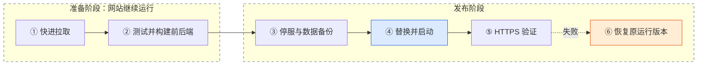

# 日常发布速查

完整说明见 [项目使用说明](doc/项目使用说明.md)。正式代码使用 GitHub `main` 分支；源码在本机修改，服务器只拉取和运行。

## 1. 本地检查、提交和推送

```bash
cd /Users/dugenkui/workspace/medical_animation
git pull --ff-only origin main
# 完成需要的本地修改后：
bash scripts/check.sh
git status --short
# 按实际改动选择文件，不要添加真实配置或数据。
git add README.md doc/ scripts/ deploy/ backend/internal/ frontend/src/
git diff --cached --check
git diff --cached
git commit -m "说明本次改动"
git push origin main
```

`git add` 的文件列表只是示例；如修改了其他文件，按实际范围选择。每次推送后，在服务器发布才会影响网站。

## 2. 服务器拉取并发布

```bash
ssh root@8.140.222.12
cd /opt/website_test
bash deploy/update.sh
bash deploy/status.sh
```

`update.sh` 要求工作副本干净且在 `main`，先 `git pull --ff-only origin main`，再执行新版本的 `deploy.sh`。发布时前后端先构建，成功后停止后端、备份数据库、替换程序并启动；健康检查失败会尝试恢复上一运行版本。配置和 `/opt/data/` 保留。



## 3. 查看日志与回滚

```bash
journalctl -u kpsucai -n 100 --no-pager
cd /opt/website_test
cat .deploy/running_revision
cat .deploy/last_rollback
# 仅在确认需要回退时执行：
bash deploy/deploy.sh --rollback latest
```

回滚恢复前后端运行产物、systemd 配置和备份脚本，不回滚数据库、不改变 Git 分支，也不覆盖生产密码。修改过数据库结构时，先核对旧代码兼容性。日常回退源码优先在本机 `git revert` 后推送，再正常发布。

## 4. 手动备份

```bash
bash /opt/backup_db.sh
tail -n 10 /opt/data/website_db_backup/backup.log
```

手动执行的输出在当前终端；小时 cron 输出写入 `backup.log`。SQLite 备份不包含上传素材。**禁止删除 `/opt/data/`、用 `git clean -xfd` 清理生产目录，或将 HTTP 模板覆盖到现有 HTTPS 配置。**
