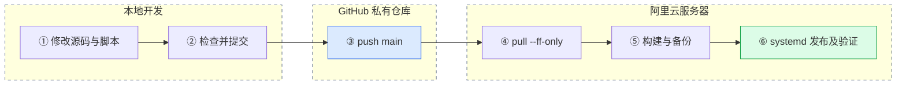

# 趣味科普网 · medical_animation

素材分发平台，支持图片、视频、音频上传，分类管理、水印预览、积分兑换和鉴权下载。

**开发与发布约定：本机开发和检查 → GitHub 推送 → 服务器拉取 → 构建、备份、重启和验证。**

- [项目使用说明](doc/项目使用说明.md)：从本地启动、提交代码到服务器发布、回滚的完整入口。
- [日常发布速查](QUICK_START.md)：经常使用的命令。
- [管理后台操作手册](USER_MANUAL.md)：分类、素材、积分、用户和运营操作。
- [服务器运维与故障恢复](doc/服务器运维与故障恢复.md)：备份、证书、监控和数据库恢复。
- [2026-10-18 运维验证快照](doc/运维验证记录_20261018.json)：当次维护证据，不代表后续实时状态。

仓库：[dugenkui03/medical_animation](https://github.com/dugenkui03/medical_animation)（私有）；正式分支：`main`；网站：[kpsucai.cn](https://kpsucai.cn)。

## 开发与部署链路



## 技术与目录

| 部分 | 实现 |
|---|---|
| 后端 | Go 1.24+、Gin、GORM、SQLite（需 C 编译器支持 CGO） |
| 前端 | React 19、Vite 7、Ant Design 6；Node.js 20.19+ 或 22.12+ |
| 素材处理 | ffmpeg 及中文字体；图片水印、视频封面 |
| 生产运行 | Nginx HTTPS、systemd、SQLite 在线备份、Certbot |

```text
backend/                   Go 后端
  config.example.json      无密码的配置模板
  config.json              当前机器的真实配置，Git 忽略
frontend/                  React 前端
scripts/                   本地初始化和提交前检查
deploy/                    服务器更新、发布、回滚、检查及系统配置模板
backup_db.sh               SQLite 在线备份
nginx.conf.template        新服务器 HTTP 起步模板
doc/                       使用说明、运维说明和验证记录
.local-data/               本地开发数据，Git 忽略
.deploy/                   服务器发布快照，Git 忽略
```

## 本地启动

安装 Go、Node.js、Python 3、ffmpeg 及 C 编译工具后：

```bash
git clone https://github.com/dugenkui03/medical_animation.git
cd medical_animation
python3 scripts/init_local.py
cd backend
go run ./cmd/server/
```

另开终端：

```bash
cd medical_animation/frontend
npm ci
npm run dev
```

访问 `http://localhost:5173`；管理员入口 `/admin-login`。本地初始化生成的随机管理员密码只保存在 `backend/config.json`。已有配置不会被初始化脚本覆盖。生产数据保存在服务器 `/opt/data/`，不随 Git 更新。

## 业务规则

- 新注册用户初始积分为 0，通过兑换码充值；兑换码无过期时间。
- 付费素材下载后 7 天内重复下载免扣积分，免费素材仍需登录下载。
- 管理员可维护素材、分类、积分、用户状态、公告和联系方式。
- 公开列表隐藏原文件路径；Nginx 仅直接公开水印预览目录，下载由后端鉴权和扣费。

生产更新请使用 [日常发布速查](QUICK_START.md)，其中包含构建、备份和回滚。代码推送本身不会自动重启网站。
