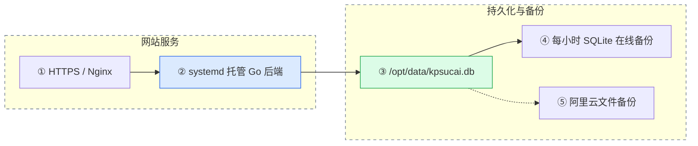

# 服务器运维与故障恢复

适用服务器：阿里云北京实例 `i-2zebg189x5305wg3j1iq`，公网 IP `8.140.222.12`，网站 `https://kpsucai.cn`。生产密码、私钥、JWT 密钥不在本文保存。

## 服务与数据链路



- 代码目录：`/opt/website_test`；正式二进制：`backend/server`。
- 后端配置：`backend/config.json`，从工作目录加载；数据库应指向 `/opt/data/kpsucai.db`，监听地址使用 `127.0.0.1:8080`。
- 登录令牌使用配置中的独立随机 `jwt_secret`，只接受有有效期的 HS256 令牌；生产配置权限为 `0600`。更换签名密钥后需要重新登录。
- 数据目录：`/opt/data`，包括数据库与 `uploads` 素材目录；更新代码时必须保留。
- 服务配置：仓库的 `deploy/kpsucai.service`，安装到 `/etc/systemd/system/kpsucai.service`。
- 启动前检查：`deploy/check_database.sh`，数据库缺失、为空或完整性异常时拒绝启动。
- Nginx 只公开 `/uploads/previews/`；原始素材由后端下载接口处理。
- 备份日志按 `deploy/kpsucai.logrotate` 每周轮转，保留 8 份。

## 日常检查

```bash
systemctl status kpsucai nginx crond certbot-renew.timer --no-pager
systemctl is-enabled kpsucai nginx crond certbot-renew.timer
curl --fail http://127.0.0.1:8080/ping
curl --fail https://kpsucai.cn/api/categories
journalctl -u kpsucai -n 100 --no-pager
df -h /opt/data
```

接口返回 `pong` 仅能证明进程能响应。注册、分类等写入故障还需核对对应请求日志和数据库落盘结果。验证生产写入时使用独立测试数据，验证后只清理本次创建的记录。

## 数据库备份

`/opt/backup_db.sh` 每小时通过 cron 执行一次。脚本使用只读连接打开原库、调用 SQLite `.backup`、校验备份完整性，再将临时文件发布为正式备份；同时运行的任务由 `flock` 合并为一次。保留最近 14 天，只有新备份成功后才清理专用目录下的过期文件。

```bash
mkdir -p /opt/data/website_db_backup
bash /opt/backup_db.sh >> /opt/data/website_db_backup/backup.log 2>&1
tail -n 10 /opt/data/website_db_backup/backup.log
crontab -l
```

cron 项：

```cron
0 * * * * /opt/backup_db.sh >> /opt/data/website_db_backup/backup.log 2>&1
```

必须在安装 cron 前创建日志目录，否则 shell 在打开重定向日志时就会失败，脚本自身的 `mkdir` 没有机会执行。数据库备份不包括上传素材；整机和素材由阿里云文件备份另行保护。阿里云控制台中“文件备份”与“云盘快照”是不同功能，不能用快照数量推断文件备份是否存在。

## 证书续期

沿用现有 Let's Encrypt / Certbot 的 Nginx 配置，不重新创建证书账户。

```bash
certbot renew --cert-name kpsucai.cn --non-interactive --no-random-sleep-on-renew
systemctl enable --now certbot-renew.timer
systemctl list-timers --all certbot-renew.timer
openssl x509 -in /etc/letsencrypt/live/kpsucai.cn/fullchain.pem -noout -dates
curl --fail https://kpsucai.cn/api/categories
```

续期依赖服务器能访问证书颁发机构，且 HTTP 验证请求能到达网站。超时应先检查网络和续期日志；不得通过关闭 TLS 校验来掩盖过期或续期失败。

`deploy/certbot-renew-retry.conf` 安装为 `/etc/systemd/system/certbot-renew.service.d/retry.conf`，失败后每小时重试，并限制单次任务最长 15 分钟。自动任务必须使用服务器自身网络，不依赖维护时临时建立的 SSH 转发。

## 主机监控与系统状态

已按[阿里云官方安装说明](https://help.aliyun.com/zh/cms/cloudmonitor-1-0/user-guide/install-and-uninstall-the-cloudmonitor-agent-for-cpp)安装 C++ 主机监控插件，服务名为 `cloudmonitor`，并启用开机启动。安装时设置 `INSTALL_LOONGCOLLECTOR=false`，只安装主机指标采集插件，不额外安装日志采集组件。

```bash
systemctl status cloudmonitor hbrclient aliyun aegis --no-pager
systemctl --failed --no-pager
tail -n 30 /usr/local/cloudmonitor/local_data/logs/argusagent.log
```

检查日志中的 `send metric summary`，确认已持续上报成功。2026-10-18 维护时服务端连续上报成功；控制台浏览器连接超时，因此未把控制台视图作为验证证据。

此实例实际可用内存约 1.8 GiB，内核启动参数对小于 2 GiB 的机器设置了 `crashkernel=0M`。`kdump` 因没有预留崩溃转储内存从首次开机起就无法启动。本次保留内核内存分配，停用该无可用内存的服务并清理失败状态；如以后升级内存并需要内核转储，再配置 `crashkernel`、重启并重新启用 `kdump`。

## 数据库只读或丢失

先查看服务 PID、实际工作目录和打开的数据库文件：

```bash
systemctl show kpsucai -p MainPID
ss -lntp '( sport = :8080 )'
ls -l /proc/实际PID/fd
readlink /proc/实际PID/cwd
```

如果数据库描述符显示 `(deleted)`，先不要停止进程或重启机器：目录中的文件虽然消失，进程仍可能保留可恢复的数据。先保存对应文件描述符、可能存在的 WAL/日志文件及运行日志，检查恢复副本完整性，再决定恢复方案。不要机械复制固定编号的描述符，必须先确认它实际指向数据库。

恢复到正式路径前需停止实际后端进程，保留现有库及附属日志，使用经过完整性校验的备份恢复。之后由 systemd 启动并验证真实写入。禁止删除 `/opt/data` 来尝试修复启动失败。

## 2026-10-18 故障记录

- 原后端 PID `85975` 从 3 月 7 日持续运行，数据库与工作目录均显示 `(deleted)`。
- 数据库旧 inode 的最后变更时间为 3 月 7 日 21:59:44；旧工作目录的最后变更时间为 21:59:51。旧日志自当晚起已有只读错误。
- root 命令历史包含多次 `rm -rf data/`、删除代码目录与 `pkill -f "go run"`，与部署清理误删、实际编译后进程未退出的状态吻合。历史无时间戳，不能确定具体哪次操作或操作者。
- 已从旧进程描述符保存原库，SHA-256 与原描述符一致，`PRAGMA integrity_check` 返回 `ok`。恢复时原库有 2 个用户、0 个分类、0 个素材；这只是当时仍被进程持有的库内容，不代表更早历史数据完整。
- 恢复证据、原二进制和配置副本保存在服务器 `/opt/recovery/kpsucai-20261018-1418/`，目录仅 root 可读。
- 同时发现网站证书于 6 月 5 日过期、续期定时器未运行、本地备份日志目录缺失，以及 Nginx 静态暴露整个上传目录。维护完成后应分别验证证书有效期、定时器、备份副本完整性与原文件访问限制。
- 网站证书已续期至 2027 年 1 月 16 日 13:27:52（北京时间）。首次续期因直连证书机构超时，通过临时 SSH 转发完成；随后关闭转发，并通过服务器直连的 `certbot renew --dry-run` 验证续期流程。定时器已恢复，失败后每小时重试。
- 已修复源码中写死的默认 JWT 签名密钥，改用服务器本地生成的随机密钥，限制签名算法和令牌有效期；本机与服务器 `go test ./...` 均通过，线上旧默认密钥签名被拒绝。
- 已通过真实公网接口验证注册、分类创建、图片上传、预览、匿名下载拒绝、鉴权下载、兑换码到账及付费素材重复下载只扣一次。测试账号、兑换码、分类、素材和文件均已清理。
- 验证报告：服务器恢复目录中的 `verification_public_free.json`、`verification_public_paid.json`；最终数据库备份为 `test_20261018_143342.db`，已校验完整性。该报告和备份是在维护当时生成的快照，后续运行状态请用上面的命令实时确认。
- 汇总快照已同步到仓库的 [运维验证记录](运维验证记录_20261018.json)，包括服务状态、证书日期及业务验证结果，不包含生产密码和签名密钥。

## 更新约束

更新顺序见 [项目使用说明](项目使用说明.md) 和 [日常发布速查](../QUICK_START.md)。本机修改、检查、commit/push 后，服务器在 `/opt/website_test` 执行 `bash deploy/update.sh`。脚本先拉取并构建前后端，再停服备份、替换和验证；发布失败会尝试恢复原运行产物，不覆盖数据库。`systemctl stop kpsucai` 会管理整个服务进程组。生产配置、数据和证书不进入仓库。
