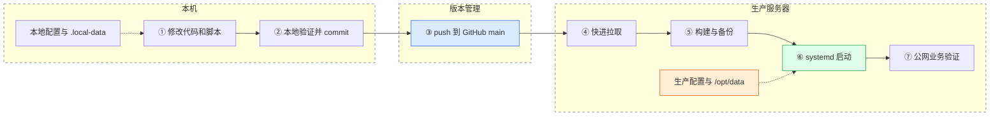

# 项目使用说明

本文是 `medical_animation` 的开发、发布和维护入口。网站业务名称为“趣味科普网”。部署约定为：**在本机开发和验证，提交并推送 GitHub；服务器拉取同一版本，构建后由 systemd 启动。**

## 1. 环境与职责

| 项目 | 位置 / 约定 |
|---|---|
| GitHub | <https://github.com/Betty52455/medical_animation>，公开仓库 |
| 发布分支 | `main` |
| 本地目录 | 克隆后项目所在的 `medical_animation` 目录 |
| 服务器 | 阿里云北京 `8.140.222.12`，SSH 用户 `root` |
| 服务器代码目录 | `/opt/website_test`；名字为历史路径，仓库名仍是 medical_animation |
| 网站 / 后台 | <https://kpsucai.cn> / <https://kpsucai.cn/admin-login> |
| 生产数据库 | `/opt/data/kpsucai.db` |
| 生产素材 | `/opt/data/uploads/originals/`、`/opt/data/uploads/previews/` |
| 服务 | `kpsucai.service`，后端监听 `127.0.0.1:8080` |

本机负责源码修改、检查、提交和推送。服务器只通过仓库获取源码，保留自己的配置、数据、TLS 证书和部署密钥。服务器使用 GitHub **只读 deploy key**，只获得此仓库的读取权限。



这是人工触发的发布流程；`git push` 完成后网站不会自动更新，必须执行服务器更新命令。

## 2. 本地首次启动

依赖：Go 1.24+、Node.js 20.19+ 或 22.12+、npm、Python 3、ffmpeg，以及 C 编译器。Go SQLite 驱动使用 CGO，macOS 可安装 Xcode Command Line Tools，Linux 使用 GCC。ffmpeg 需支持 `drawtext` 并能找到中文字体。

macOS 的精简 ffmpeg 可能不含 `drawtext`。可安装 Homebrew 的 `ffmpeg-full`，并在运行后端和业务验证的终端配置：

```bash
brew install ffmpeg-full
export PATH="$(brew --prefix ffmpeg-full)/bin:$PATH"
ffmpeg -hide_banner -filters 2>/dev/null | grep drawtext
```

```bash
git clone https://github.com/Betty52455/medical_animation.git
cd medical_animation
python3 scripts/init_local.py
```

脚本根据 `backend/config.example.json` 生成 `backend/config.json`，设置独立随机管理员密码和 JWT 密钥，数据写入仓库下的 `.local-data/`。真实配置权限为 `0600`，不会被 Git 跟踪。重复执行保留已有配置；切换配置前需自行备份原文件，禁止拿生产配置覆盖开发配置。

后端终端（在仓库根目录运行，自动优先选择已安装的 macOS ffmpeg-full）：

```bash
bash scripts/dev_backend.sh
```

前端终端：

```bash
cd frontend
npm ci
npm run dev
```

打开 `http://localhost:5173`。注册入口 `/register`，管理员入口 `/admin-login`。本地管理员用户名默认为 `admin`，随机密码在本机的 `backend/config.json` 查看。

首次启动会创建数据库并初始化管理员。已有管理员不会被配置文件中的密码覆盖，因此编辑 `admin.password` 不等于重置数据库里的管理员密码。更换 `jwt_secret` 会让已签发登录会话失效。

## 3. 配置与数据的边界

| 配置字段 | 用途 | 本地 | 当前生产 |
|---|---|---|---|
| `server_port` | HTTP 监听 | `127.0.0.1:8080` | `127.0.0.1:8080` |
| `database_path` | SQLite 文件 | `.local-data/kpsucai.db` 的绝对路径 | `/opt/data/kpsucai.db` |
| `upload_dir` | 专用素材目录 | `.local-data/uploads` 的绝对路径 | `/opt/data/uploads` |
| `jwt_secret` | 登录签名密钥 | 初始化生成 | 服务器单独保管 |
| `admin` | 首次建库管理员 | 随机密码 | 以已有生产数据为准 |

`config.example.json` 的密码和密钥为空，只用于说明字段，不能直接作为运行配置。旧生产配置不含 `upload_dir` 时，程序继续使用 `/opt/data/uploads`。

**入库内容**：前后端源码、依赖锁文件、配置模板、部署/备份脚本、systemd/logrotate 模板、使用说明。

**机器本地保留内容**：`backend/config.json`、数据库及日志文件、上传素材、`.local-data/`、`.deploy/`、编译产物、依赖目录、证书和私钥。不要使用 `git add -f` 强制提交这些文件，也不要在服务器执行 `git clean -xfd`。

## 4. 日常开发与推送

```bash
cd /path/to/medical_animation
git pull --ff-only origin main
# 本地修改代码并运行相应功能验证。
bash scripts/check.sh
git status --short
# 根据实际修改选择文件，例如：
git add backend/internal/ frontend/src/ scripts/ deploy/ README.md doc/
git diff --cached --check
git diff --cached
git commit -m "描述问题和改动"
git push origin main
```

`scripts/check.sh` 执行后端测试与编译、`npm ci`、前端生产构建和空白检查，构建产物放在临时目录。它不访问生产数据库；功能修改仍需在本地验证真实请求。前端 `npm run lint` 可单独运行，其结果不包含在此脚本的“通过”结论中。

安装好 ffmpeg 后，可运行 `python3 scripts/smoke_local.py`。它以随机端口、临时配置和独立数据库启动真实后端，验证注册、分类、图片上传、预览和鉴权下载，结束时清理自己的进程和数据。

较大的改动可以在 `codex/功能名` 分支开发，合并到 `main` 后再部署。服务器始终使用 `main`，遇到分叉或未提交改动会停止，不会强制覆盖。

## 5. 服务器发布

```bash
ssh root@8.140.222.12
cd /opt/website_test
bash deploy/update.sh
bash deploy/status.sh
```

`update.sh` 获得发布锁后检查分支和工作副本，执行 `git pull --ff-only origin main`，再启动刚拉取的 `deploy.sh`。`deploy.sh` 本身只部署当前检出的版本，不做拉取；需要重新构建同一提交时可以直接执行。

发布步骤：

1. 校验生产路径、配置权限、数据库与 Nginx，要求当前服务正常。
2. 当前网站继续运行，先完成 Go 测试/构建、`npm ci` 和前端构建。
3. 保存上一版本的后端、前端、服务配置、备份脚本和运行版本。
4. 通过 systemd 停止后端，在独立发布快照目录备份停稳后的数据库。
5. 原子替换后端二进制，更新前端静态资源与服务文件，启动后端。
6. 验证后端 `/ping`、本机 Nginx HTTPS 首页与分类 API；失败时先报告，再尝试恢复上一运行版本。
7. 操作者从公网检查本次改动涉及的注册、分类、上传或下载功能。

构建阶段不停止服务；替换期间有短暂停机。HTTPS 检查固定连接本机 Nginx，但仍校验证书和域名。发布不会修改现有 Nginx HTTPS 配置、证书、SSH 密码和应用密钥。监控、证书续期、cron、logrotate 模板变更需要按运维手册单独安装；发布脚本只自动更新后端服务单元和备份脚本。

检查运行版本：

```bash
git rev-parse HEAD
cat .deploy/running_revision
journalctl -u kpsucai -n 100 --no-pager
curl --fail https://kpsucai.cn/api/categories
```

Git 提交号表示工作副本版本，`running_revision` 表示最近成功发布的运行产物版本。失败或手动回滚时两者可能不同。健康检查不创建测试账号，不替代业务写入验证。

## 6. 回滚与数据恢复

每次发布快照位于 `.deploy/releases/时间-提交-进程号/`，其中保存的是**发布前**的运行产物以及停服后的数据库备份。最新可回滚快照 ID 记录在 `.deploy/last_rollback`。

```bash
cd /opt/website_test
cat .deploy/last_rollback
# 确认需要恢复上一运行版本后：
bash deploy/deploy.sh --rollback latest
# 也可以将 latest 替换为准确的快照 ID。
```

回滚前也会保存当前运行版本和数据库，便于恢复操作本身。回滚只恢复前后端产物、服务配置和备份脚本，**不会把旧数据库覆盖到新数据库**，也不改变源码分支和生产密码。源码长期回退应在本机 `git revert`、推送并重新发布。

数据库结构由 GORM 启动时自动迁移。涉及删列、改类型或不兼容数据转换的改动，必须先明确兼容性和恢复步骤；不能依赖程序回滚撤销数据库迁移。数据库误删或损坏时遵循 [故障恢复手册](服务器运维与故障恢复.md)，尤其是进程仍持有 `(deleted)` 文件时，应先抢救数据再停进程。

发布快照不自动清理。定期检查 `.deploy/` 大小，在确认保留最新可回滚版本且已有独立备份后，人工清理明确过期的快照。小时数据库备份独立保存在 `/opt/data/website_db_backup`，保留 14 天；上传素材需另行备份。

## 7. 脚本和配置索引

| 文件 | 运行位置 | 作用 |
|---|---|---|
| `scripts/init_local.py` | 本机 | 初始化开发配置与数据路径，保留已有配置 |
| `scripts/dev_backend.sh` | 本机 | 检查水印依赖并启动本地后端 |
| `scripts/check.sh` | 本机 | 提交前测试、编译和前端构建 |
| `scripts/smoke_local.py` | 本机 | 临时环境真实业务验证，不访问生产数据 |
| `deploy/update.sh` | 服务器 | 加锁、快进拉取 `main`、发布 |
| `deploy/deploy.sh` | 服务器 | 当前提交发布、健康检查和运行版本回滚 |
| `deploy/status.sh` | 服务器 | 只读检查版本、服务、数据库、证书和公网接口 |
| `deploy/check_database.sh` | 服务器 | 启动前检查数据库存在且可读、完整 |
| `backup_db.sh` | 服务器 `/opt/backup_db.sh` | 在线备份、完整性校验、防重叠与保留期 |
| `deploy/kpsucai.service` | `/etc/systemd/system/` | 正式二进制、重启策略及文件系统写权限 |
| `deploy/kpsucai.logrotate` | `/etc/logrotate.d/kpsucai` | 备份日志轮转 |
| `deploy/certbot-renew-retry.conf` | certbot service drop-in | 续期失败重试 |
| `nginx.conf.template` | 新环境参考 | HTTP 反代和预览目录；不能覆盖已有 HTTPS 配置 |

## 8. 新服务器或重建服务器

日常更新脚本面向已经运行的当前生产环境，**不是空机一键安装脚本**。新机需依次准备：

1. 安装 Git、Go、GCC、Node.js/npm、Python 3、SQLite CLI、ffmpeg/中文字体、Nginx、Certbot，以及提供 `flock` 的 util-linux。
2. 公开仓库可通过 HTTPS 只读克隆。若沿用 SSH deploy key，保持只读并核对 GitHub 官方主机密钥，私钥留在服务器。
3. 将仓库 clone 到 `/opt/website_test`，恢复 `/opt/data/` 和独立保管的生产配置，配置权限设为 `0600`。
4. 先验证数据库备份完整性，再恢复数据库和素材。确认全新环境需要建库时才手动启动后端初始化；旧站迁移不得以自动新建空库代替恢复。
5. 编译 Go 正式二进制、`npm ci && npm run build`，安装仓库的 systemd 服务单元和备份脚本，`systemctl daemon-reload` 后 `enable --now kpsucai`。
6. 配置 Nginx、域名解析和有效证书，安装备份 cron、日志轮转、证书续期定时器与主机监控。
7. 完成 HTTPS 和真实业务读写验证后，再使用日常 `deploy/update.sh` 流程。

服务器若沿用 SSH deploy key，它只用于访问 GitHub 仓库；管理员连接 ECS 使用的 SSH 密码是另一套认证。更换 GitHub 认证不需要更换服务器登录密码。仓库不存在密码时，应从对应机器或管理员的密码保管渠道获取，不要在文档或提交信息中补写密码。

## 9. 常用维护与业务操作

```bash
# SSH 到服务器后执行
bash /opt/website_test/deploy/status.sh
journalctl -u kpsucai -f
bash /opt/backup_db.sh
systemctl list-timers --all certbot-renew.timer
```

管理员可创建分类、上传素材、生成兑换码和管理用户；详细页面操作见 [管理后台操作手册](../USER_MANUAL.md)。用户先注册登录，通过兑换码获得积分后下载；免费素材也需要登录。

证书续期、阿里云监控、素材备份和只读数据库排查见 [服务器运维与故障恢复](服务器运维与故障恢复.md)。2026-10-18 的修复报告是当时快照，检查当前状态请运行上面的只读命令。
